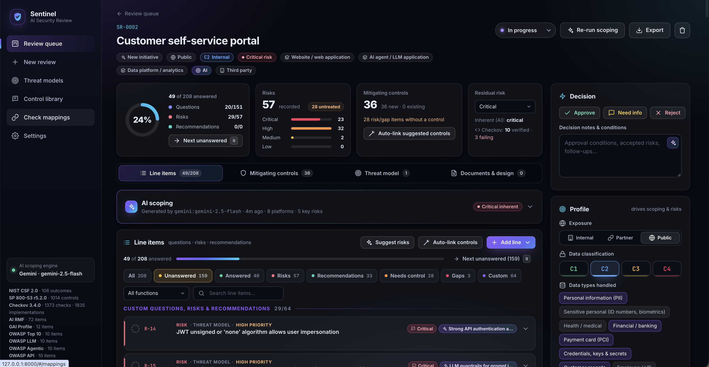

# Sentinel: AI Security Review

A queue-based workspace for running security design reviews of **new initiatives and changes**.
You describe the change, AI picks the relevant NIST requirements, and the reviewer works through them.
Each requirement links down to SP 800-53 controls and then to Checkov technical checks.

```
NIST CSF 2.0 subcategory  (the review question, e.g. PR.DS-01)
  └─ SP 800-53 Rev 5 controls  (NIST's official CSF → 800-53 mapping, e.g. SC-28, SC-12)
       └─ Checkov checks  (IaC policies that implement those controls, e.g. CKV_AWS_19)
```

## Quick start (Docker)

```bash
cp .env.example .env        # set POSTGRES_PASSWORD and APP_SECRET_KEY
docker compose up -d --build
```

Open http://127.0.0.1:8000 and sign in, or register. With `DEMO_USER_ENABLED=true` these logins exist (password =
username); `DEMO_SEED_DATA=true` also fills each workspace with its own sample reviews, a threat model with code,
and a treated risk with controls:

| Login | Demo workspace | Platform team | Data team |
|---|---|---|---|
| `demo` | admin | admin | admin |
| `alice` | write | write | - |
| `bob` | write | - | write |
| `carol` | read | read | read |

| Service | Role |
|---|---|
| `postgres` | Database (named volume `pgdata`) |
| `redis` | Celery broker |
| `migrate` | Runs `alembic upgrade head` and creates the demo user, then exits |
| `api` | FastAPI + SPA (uvicorn, `API_WORKERS` processes) |
| `worker` | Celery workers running background jobs (document analysis, code review, fix generation, threat modelling) |
| `autoscaler` | Scales `worker` containers with load |

Uploads live in the shared `uploads` volume, so the API and every worker see the same files.

**Job queue.** The **Jobs** page (sidebar; badge = active jobs) lists every background job in the workspace with
progress, AI calls and tokens used, who started it and how long it has run. **Cancel** stops a job within a few
seconds, including AI calls in flight, and work already saved is kept. **Purge** (admins) cancels every queued and running job.
Cancelled jobs are never resumed, even when a worker restarts. As a safety net, a job that reaches `JOB_MAX_AI_CALLS`
AI calls (default 300) is stopped. Generating more than 10 fixes at once asks for confirmation first.

**Autoscaling.** Every `AUTOSCALE_POLL_SECONDS` the autoscaler reads the Redis queue length plus the jobs workers have
reserved, and runs `ceil(load / WORKER_CONCURRENCY)` worker containers, between `MIN_WORKERS` and `MAX_WORKERS`.
It scales out straight away, and scales in only after demand has stayed lower for `AUTOSCALE_SCALE_DOWN_DELAY` seconds.
A worker that is scaled in finishes its running job first (`WORKER_STOP_GRACE`). Jobs use late acknowledgement,
so a job lost with its worker is run again. The autoscaler calls `docker compose` through the mounted Docker socket.
That gives it root-level access to the host, so only run it on hosts you control.

## Local development

```bash
python -m venv .venv && source .venv/bin/activate
pip install -r requirements.txt

# Build data/catalog.json (downloads NIST sources once into data/raw/, parses Checkov statically)
python scripts/build_catalog.py            # --refresh to re-download, --checkov-path to point elsewhere

docker compose up -d postgres redis        # set DATABASE_URL / CELERY_BROKER_URL in .env to the localhost ports
python main.py                             # migrates, then http://127.0.0.1:8000  (--port, --host, --reload)
celery -A app.worker worker --loglevel=INFO   # background jobs
```

Optional demo data: `python scripts/seed_demo.py` adds 10 realistic reviews covering every status to the demo user's
workspace (`--login you@example.com` to seed your own); `--all-workspaces` splits them across the three demo
workspaces instead. Use `--reset` to recreate them, `--remove` to delete them, and
`--use-ai` to scope them with the workspace's configured provider. Only the demo reviews are touched.

**Importing a SQLite database from an earlier version:** run this against a freshly migrated database. Review, item,
control and document ids are kept, so the import stops if any of them already exist.

```bash
docker compose run --rm -v "$PWD/data:/import:ro" api \
  python scripts/import_sqlite.py --sqlite /import/reviews.db --uploads-src /import/uploads --user demo
```

## Accounts, workspaces and access

- **Registration**: anyone can register with an email and password (turn this off with `ALLOW_REGISTRATION=false`).
  No email is sent. The 6-digit verification code is printed to the API console (`docker compose logs -f api`).
  Registering creates a workspace, and the new user is its admin.
- **Workspaces**: reviews, threat models, uploads, check mappings, AI settings, GitLab credentials and the AI cache all
  belong to a workspace. Only the built-in catalog is shared. Users can belong to several workspaces and switch
  between them from the sidebar.
- **Roles (RBAC)** per workspace: `read` (view only), `write` (create and edit), `admin` (also manages members,
  AI provider keys, GitLab credentials and every API key in the workspace).
- **Passwords and API keys** are hashed with argon2id. Accounts lock for `LOCKOUT_MINUTES` after
  `MAX_LOGIN_FAILURES` failed sign-ins.
- **Browser sessions** use an HttpOnly cookie with a server-side session, plus a CSRF token on changes.
  Set `COOKIE_SECURE=true` behind HTTPS.
- **Workspace secrets** (AI keys, GitLab token) are encrypted at rest with a key derived from `APP_SECRET_KEY`.
  They are only used server-side (AI and git calls run in the API and the workers). The browser only ever sees "set" and a masked hint.
- **Browser hardening**: every response sends `nosniff`, `X-Frame-Options: DENY`, a referrer policy and a permissions policy.
  The UI has a strict Content Security Policy (scripts only from the app and the Mermaid CDN). API responses use a
  `default-src 'none'` policy with `no-store`. HSTS is added when `COOKIE_SECURE=true`. Uploaded documents that can carry
  script (HTML, SVG, XML…) are downloaded, never rendered in the app's origin.
- **Operator CLI**: `python -m app.cli create-user --email you@example.com` creates a verified admin.
  `python -m app.cli migrate` and `python -m app.cli bootstrap` run migrations and create the demo users and workspaces.

## API

Everything the UI does goes through the REST API under `/api`. Interactive docs are at `/docs` (`ENABLE_DOCS`).
Create an API key in **Settings → API keys** and send it as a bearer token:

```bash
curl -H "Authorization: Bearer sntl_..." http://127.0.0.1:8000/api/reviews
```

A key belongs to one workspace. Its role is the lower of the role chosen when it was created and its owner's current
role in that workspace. Background jobs return a `job_id`; poll `GET /api/jobs/{id}`. `GET /api/health` needs no auth.

## Workflow

1. **New review**: the requester gives a description, tech stack and risk flags (internet facing, personal data, third party, AI…).
2. **AI scoping** selects in-scope CSF subcategories, says why each one applies, and detects technologies, services and key risks.
   You can edit, add or remove any of it, and re-running scoping keeps your manual changes.
3. **Assess**: for each requirement, record the team's response, reviewer notes and a status (Met / Partial / Not met / N/A).
   Under each requirement you'll see its 800-53 controls and the ranked Checkov checks, filtered to your platforms.
   Mark each check Pass / Fail / Exception / N/A.
4. **Decide**: the review moves `new → in_progress → awaiting_info → approved / rejected` (you can drag cards on the board).
   **Export** a Markdown report.

**Devil's advocate and AI review.** Content boxes (line items, controls, code findings, threat-model threats,
mitigations, test cases, DREAD rationales, attack-tree nodes, design summary, review / threat-model details) carry a
selection checkbox and a small red devil. Click the devil to argue an entry is wrong or not aligned with the
application. The AI judges the challenge against the application's evidence (upheld / partly upheld / rejected /
inconclusive), then you can apply its corrected text, write your own or remove the entry. Select one or many boxes to
run an **AI review** (a constructive check for accuracy and specificity) or a **devil's advocate** pass over all of them as a
background job (`AI_BATCH_CONCURRENCY` AI calls in parallel), then apply, override or remove per entry. The review header's
**Devil's advocate** button does this for a whole review: choose which risks, recommendations, controls, questions
and details to challenge (up to 300 entries per run). Every outcome is
recorded in the activity log. Requires the `write` role and an AI provider; overriding and removing work without AI.

## AI providers

Each workspace sets its provider, model and API key in **Settings**; keys are stored encrypted in Postgres. `AI_PROVIDER`, `AI_MODEL` and the base URLs in `.env` only set the defaults for new workspaces:

| Provider | Notes |
|---|---|
| `heuristic` | Default. Works offline using the keyword and flag triggers in `catalog/csf_questions.yaml` |
| `openai` | Any OpenAI-compatible endpoint (Azure OpenAI, LM Studio, vLLM…) via `OPENAI_BASE_URL` |
| `anthropic` | Claude models |
| `gemini` | Google Gemini |
| `ollama` | Local models |

The AI only chooses requirements from the catalog. Its output is checked against the catalog, and if the AI fails the app falls back to the heuristic.

## Data sources & customisation

| File | Purpose |
|---|---|
| `catalog/csf_questions.yaml` | Reviewer-style question, scope (project/org), baseline flag and triggers for each of the 106 CSF 2.0 subcategories |
| `catalog/checkov_nist_rules.yaml` | **Checkov → 800-53 mapping**: labelled regex keyword rules (high confidence) plus Checkov category defaults (low confidence, informational only). Each check's controls are stored with their provenance in `catalog.json` (`check.mapping`) |
| `catalog/csf_check_links.yaml` | **Requirement → check links**: for every CSF 2.0 subcategory either `checks: none` (organisational) or a link spec (`controls`, `categories`, `include` / `exclude` name regexes, explicit `checks`) with a one-line `why`. Read at startup - restart the app after editing |
| `catalog/frameworks/*.yaml` | Additional requirement frameworks used alongside CSF (NIST AI RMF 1.0, NIST AI 600-1, OWASP Top 10:2025, LLM 2025, API 2023, Agentic 2026): official text plus question, scope, baseline, triggers and an `applies_when` profile condition. Loaded at startup - no catalog rebuild needed |
| `scripts/build_catalog.py` | Merges the NIST CSF 2.0 reference tool (CPRT), the OSCAL SP 800-53 r5 catalog and Checkov into `data/catalog.json` |

> **Note:** open-source Checkov does not ship a NIST mapping, so `checkov_nist_rules.yaml` is this project's own mapping and you can edit it.
> The CSF → 800-53 links are NIST's official informative references.
> After editing `csf_questions.yaml` or `checkov_nist_rules.yaml`, re-run `python scripts/build_catalog.py` (it also validates `csf_check_links.yaml`).

Checks are linked to a requirement only through its spec in `csf_check_links.yaml`, never through NIST's broad CSF → 800-53 references.
A check matches when one of its rule-derived controls is in the spec's `controls` (or its category is in `categories`) and its name passes the `include` / `exclude` filters.
Explicit ids and rule-derived matches are *strong*; category-only matches without an `include` filter are *related*. Every link carries a human-readable reason.
Requirements without a spec (e.g. other frameworks) get no automatic checks.

Reviewers can correct links on the **Mappings** page (`#/mappings`, applies to all reviews in the workspace, with YAML export / import) or inline under a requirement in a review (this review only, or all reviews in the workspace).
These overrides are stored in the `check_links` table and merged in order: automatic → all-reviews include/exclude → review include/exclude.
A review's platforms filter the checks shown; if none of them match a Checkov platform, all platforms are shown instead.

## Layout

```
app/            FastAPI backend (api, auth, catalog, db, jobs, worker, report, ai/providers, ai/scoping)
migrations/     Alembic migrations (Postgres schema)
static/         Vanilla JS SPA (hash router, views/) + CSS design system
catalog/        Hand-maintained YAML (questions, Checkov→NIST rules, requirement→check links)
scripts/        Catalog builder, demo seeding, SQLite import
deploy/         Worker autoscaler image
data/           catalog.json (generated), raw/ (downloaded sources), uploads/ (local runs)
references/     Checkov source tree used for parsing
```
